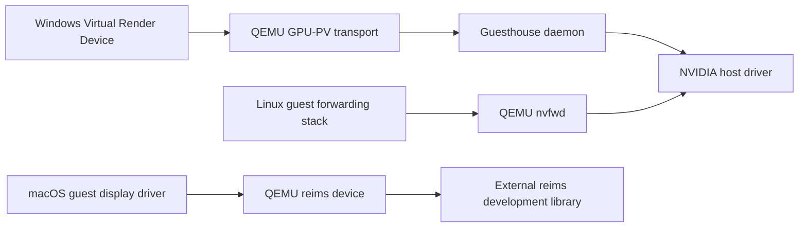

# vNVGPU

**NVIDIA Ampere GPU sharing for Linux/KVM guests.** vNVGPU brings together a Guesthouse GPU-PV backend for Windows, QEMU `nvfwd` for Linux, and a reims display integration for macOS. The repository includes the Rust workspace, 47 version-pinned Proxmox QEMU patches, and the probes used to test allocation ownership, video-memory accounting, and graphics capability discovery.

[简体中文](README.zh-CN.md) · [Architecture](#architecture) · [Engineering changes](#engineering-changes) · [Validation](#validation) · [Build](#build-the-daemon) · [Repository map](#repository-map)

| Release verification | Result |
|---|---|
| Rust backend and core tests | 771 passed in the source release validation |
| NVIDIA daemon build | Release build succeeded on x86-64 Linux |
| QEMU integration patches | 47 reapplied with zero fuzz, 76 affected paths matched byte for byte |
| Windows H.264 hardware decode | Earlier hardware candidate matched all 600 reference frames on CUVID and all 600 on D3D11VA |

## Architecture



The Windows path forwards rendering and memory operations through GPU-PV. The Linux path forwards supported NVIDIA driver operations through the QEMU device. The macOS path exposes a display device using the separately supplied reims library. The integration retains distinct guest device models and build dependencies. [Architecture and component boundaries](docs/architecture.md)

## Engineering changes

| Area | Work in the integration | How it was checked |
|---|---|---|
| Windows transport | Support an opt-in protocol 43 configuration and return size-correct statistics responses | Compare capability-query scope, response length, and NTSTATUS at the guest boundary |
| Ampere channels | Set up graphics, copy, encode and decode queues with the appropriate device parent, USERD mapping, and scheduling path | Check hardware fence retirement and compare decoded output to a software reference |
| Memory lifetime | Release private USERD mappings before refunding their budget, and retain charges for outstanding exports | Close 16 graphics channels and check for a residual charge. Hold an export and test the admission boundary |
| Process accounting | Filter allocation usage by owner and track local versus system-backed allocation classes | Compare independent D3D11 holder and observer processes and test both release orders for shared allocations |
| QEMU integration | Handle GPU-PV backend loss, defer Linux device startup to VM execution, separate the device aperture from VFIO DMA mapping, and mirror graphics to the console | Replay the exact patch stack and compare the affected files. Historical builds also ran device enumeration and display qtests |

## Validation

**Memory isolation.** In the hardware comparison, an observer process held at zero while a separate D3D11 process allocated 8 or 32 MiB. The configured 5 GiB limit remained in effect. In the channel-lifetime experiment, the original implementation retained a 1 MiB charge after 16 closes and the updated implementation returned to baseline. [Memory and ownership case study](docs/memory-accounting.md)

**Video correctness.** Windows CUVID and D3D11VA each produced 600 distinct NV12 frames that matched the software reference byte for byte on the earlier hardware-tested candidate. A process exit status and an application launch are separate checks from output correctness. [Validation matrix and open cases](docs/validation.md)

**Protocol behavior.** Open interface definitions establish candidate field layouts. Bounded guest probes then compare expected statuses and field offsets with the host response. The fixed-size statistics refusal test separates unsupported functionality from a malformed transport reply. [Protocol debugging case study](docs/protocol-debugging.md)

## Build the daemon

Use x86-64 Linux, Rust 1.88 or newer, and a native linker.

```sh
cd guesthouse
cargo test --locked --lib -p guesthouse-backend -p guesthouse-core -p guesthouse-backend-nvidia
cargo build --locked --release -p guesthouse-daemon --features nvidia
```

The QEMU integration uses the Proxmox `pve-qemu-kvm 11.1.3-2` source package with its stock Quilt patches applied. Runtime verification requires a compatible NVIDIA driver and guest installation. The build guide describes base preparation, ordered patch replay, and device discovery. [Build and test guide](docs/build-and-test.md)

## Repository map

| Directory | Contents |
|---|---|
| [guesthouse](guesthouse) | Buildable Rust workspace with GPU-PV session handling, backend libraries, transport, daemon, and regression tests |
| [patches/pve-qemu](patches/pve-qemu) | Ordered QEMU integration patch series and upstream license notices |
| [probes](probes) | Windows API probes and NVIDIA resource-lifetime test programs |
| [docs](docs) | Architecture, build steps, protocol and memory investigations, and validation results |

## Current limitations

The published Rust snapshot exposes tested budget and allocation statistics. The native Windows Task Manager GPU view remained unresolved in hardware tests. The complete three-guest weighted scheduling targets also remain open. The cross-platform paths rely on separately installed driver and guest components. [Validation matrix](docs/validation.md)

## Provenance and licenses

The Rust workspace derives from Guesthouse. The recorded baseline is commit `86bf70077aab3ebb696d43ee9433c4f0b95e8465` with tree `fc3d2e64570c68f6b47917b515c2330189f6282e`. The workspace includes the source required to build without fetching that archived commit. The QEMU integration builds on QEMU and Proxmox pve-qemu. Individual source notices remain applicable. [Guesthouse upstream](https://github.com/xnixy/guesthouse) · [Guesthouse license](guesthouse/LICENSE) · [Third-party notices](guesthouse/THIRD-PARTY.md) · [QEMU license](patches/pve-qemu/LICENSE) · [Packaging copyright](patches/pve-qemu/debian/copyright)
